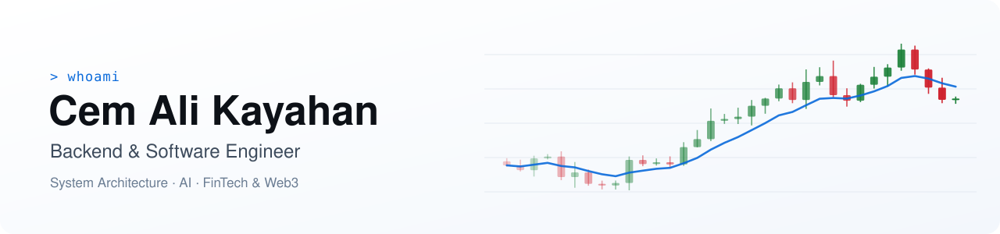

<picture>
  <source media="(prefers-color-scheme: dark)" srcset="assets/banner-dark.svg">
  
</picture>

  
  
  

I build backend systems and the products around them — APIs, data models, service
architecture, and the web and mobile apps on top. Most of my work sits where **AI**,
**fintech** and **Web3** meet. Right now I'm building [**bottomUP**](https://bottomup.app).

## Featured projects

<table>
  <tr>
    <td width="50%" valign="top">
      <h3><a href="https://github.com/cemxbt/nestjs-auth-starter">nestjs-auth-starter</a></h3>
      
Authentication for NestJS APIs: short-lived JWTs, rotating refresh sessions with token-reuse detection, and role-based access control.

      

      NestJS · Prisma · PostgreSQL
    </td>
    <td width="50%" valign="top">
      <h3><a href="https://github.com/cemxbt/fullstack-monorepo">fullstack-monorepo</a></h3>
      
An API, a web app and a mobile app sharing one typed contract package — change a schema once and every client follows.

      

      Turborepo · NestJS · Next.js · Expo · Zod
    </td>
  </tr>
  <tr>
    <td width="50%" valign="top">
      <h3><a href="https://github.com/cemxbt/ai-service-gateway">ai-service-gateway</a></h3>
      
One endpoint in front of multiple LLM providers, with model routing, automatic fallbacks, retries, per-key rate limits and cost tracking.

      

      NestJS · OpenAI · Anthropic · Docker
    </td>
    <td width="50%" valign="top">
      <h3><a href="https://github.com/cemxbt/event-driven-engine">event-driven-engine</a></h3>
      
A transactional outbox on PostgreSQL: atomic event publishing, competing workers, idempotent consumers, retries and dead-lettering.

      

      PostgreSQL · TypeScript · SQL
    </td>
  </tr>
  <tr>
    <td width="50%" valign="top">
      <h3><a href="https://github.com/cemxbt/fintech-data-pipeline">fintech-data-pipeline</a></h3>
      
Market-data ingestion with validation, data-quality reports and technical indicators, loaded idempotently into PostgreSQL.

      

      PostgreSQL · TypeScript · RSI · MACD · VWAP
    </td>
    <td width="50%" valign="top">
      <h3><a href="https://github.com/cemxbt/profitcode">profitcode</a></h3>
      
An educational platform that teaches technical analysis for financial markets, with courses, reviews and an admin area.

      

      Next.js · Supabase
    </td>
  </tr>
</table>

## Tech stack

<picture>
  <source media="(prefers-color-scheme: dark)" srcset="https://skillicons.dev/icons?i=ts%2Cnodejs%2Cnestjs%2Cprisma%2Cpostgres%2Cnextjs%2Creact%2Csupabase%2Cdocker%2Cgithubactions&theme=dark">
  
</picture>

Also: React Native · Expo · Turborepo · pnpm · Zod · REST APIs · JWT / RBAC · Railway · Render · Cloudflare Tunnel · Cursor · Claude · Codex

## What I focus on

- **Backend engineering** — APIs, business rules, authentication and data-heavy services
- **System architecture** — modular services, shared engines and reliable messaging
- **Full-stack products** — admin dashboards and mobile apps on top of the backend
- **AI & fintech** — LLM integrations, financial data and trading-oriented products

> I turn complex product needs into reliable, maintainable systems — clear architecture,
> well-structured data and pragmatic decisions over clever ones.

Open to backend, architecture and AI-driven collaborations · <a href="mailto:cemalikayahan@gmail.com">cemalikayahan@gmail.com</a>

